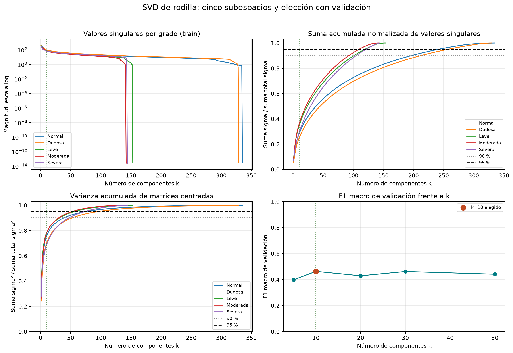
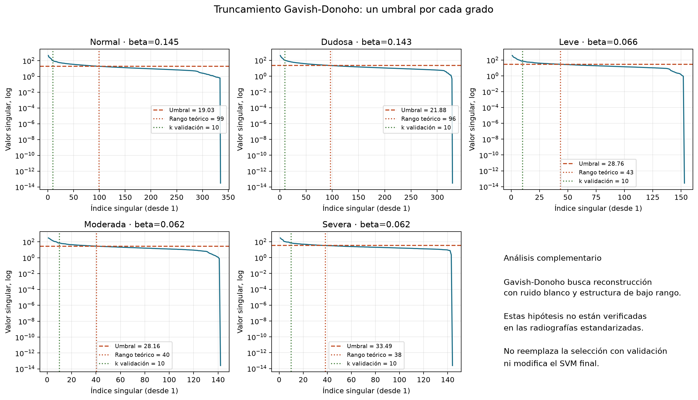
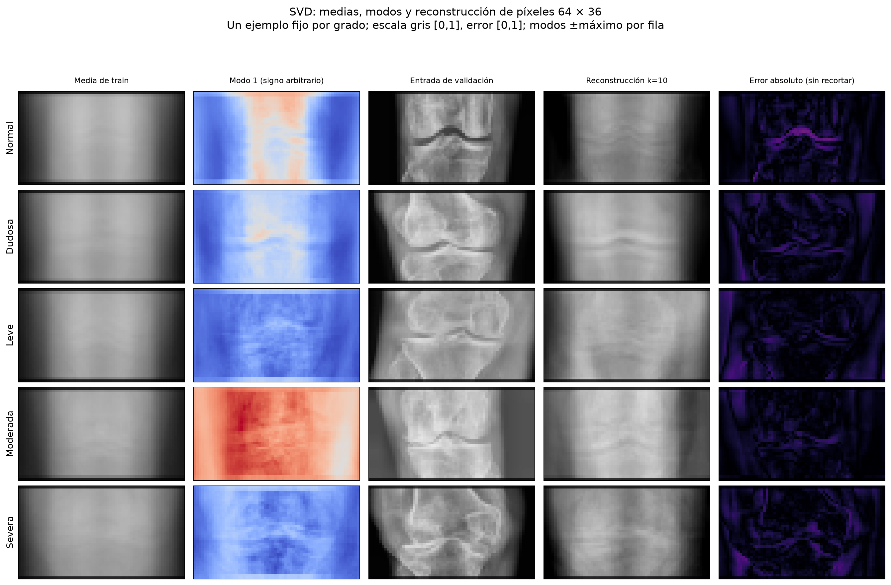

# Preparación de defensa: artrosis de rodilla

Jorge Javier Palma Martínez · Machine Learning 1 (23433) · FIUNA · 2026

Versión: rectangular-masked-v3-2026-11-22. Guion para 14 diapositivas y 112 preguntas con respuestas, basado en el código y los resultados guardados. Las preguntas reales pueden ser distintas.

## 1. Ficha para memorizar

| Dato | Valor vigente |
| --- | --- |
| Tarea | Clasificación supervisada de cinco grados ordenados |
| Etiquetas | 0 Normal, 1 Dudosa, 2 Leve, 3 Moderada, 4 Severa |
| Fuente | Annotated Dataset for Knee Arthritis Detection, Kaggle |
| Originales | 1.650 imágenes |
| Exclusiones | 68 copias exactas y 6 imágenes con etiquetas contradictorias |
| Muestra limpia | 1.576 imágenes |
| Particiones | Train 1.103; validación 236; test 237 |
| Ajuste final | Train + validación: 1.339 imágenes |
| Entrada por vista | 256 de ancho × 144 de alto, sin estirar ni recortar |
| Relleno añadido | 4,83 % medio en el experimento de train/validación; antes 46,47 % |
| Características | 288: 256 HOG + 32 estadísticas |
| Pipeline final | StandardScaler → SVC RBF |
| Parámetros | C=1; gamma='scale'; class_weight='balanced'; random_state=42 |
| Selección | Mayor F1 macro de validación entre 33 candidatos |
| F1 de validación | 0,629974, aproximadamente 0,6300 |
| Accuracy de test | 71,31 %: 169 aciertos de 237 |
| Balanced accuracy | 72,09 % |
| F1 macro de test | 0,7155 |
| Precisión / recall macro | 0,7110 / 0,7209 |
| Kappa cuadrático | 0,8567 |
| Vectores soporte | 1.258 sobre 1.339 imágenes del ajuste final |
| Gamma efectivo | Aproximadamente 0,00347222, es decir 1/288 |
| SVD comparado | k=10; F1 macro de validación 0,4629; no integra el SVM final |
| Límite central | Test reutilizado; sin IDs de paciente ni validación externa |

**No mezclar versiones:** 0,6031 es el F1 de validación del experimento rectangular con máscara con SVM C=10 y ANOVA160. El modelo final es SVM C=1, sin ANOVA, con F1 de validación 0,6300 y F1 de test 0,7155. El 0,7207 pertenece al test de la versión limpia anterior.

## 2. Guion de 8 a 10 minutos

Texto sugerido en primera persona. Usalo para ensayar ideas, sin leerlo palabra por palabra. Los tiempos son orientativos: comprobá la duración con un ensayo completo.

### Diapositiva 1. Presentación · 20 segundos

Mi nombre es Jorge Javier Palma Martínez. Mi proyecto estudia la clasificación de radiografías de rodilla en cinco grados de artrosis mediante procesamiento de imágenes y modelos clásicos de machine learning. Voy a presentar cómo preparé los datos, cómo comparé las alternativas y cuáles son los resultados y las limitaciones del modelo final.

### Diapositiva 2. Problema y objetivos · 35 segundos

La entrada es una radiografía y la salida es una de las cinco etiquetas del dataset: Normal, Dudosa, Leve, Moderada o Severa. El objetivo es construir un pipeline reproducible para comparar métodos y analizar errores. Su relación con bioelectrónica está en el procesamiento de imágenes biomédicas y el análisis de información adquirida por instrumentación médica. No desarrollé el equipo de rayos X ni presento el sistema como un dispositivo de diagnóstico.

### Diapositiva 3. Auditoría y limpieza · 45 segundos

El dataset original contiene 1.650 imágenes. Antes de dividirlo, calculé un hash de la forma y los píxeles decodificados de cada imagen. Así encontré copias con nombres diferentes y grupos con etiquetas contradictorias. Excluí 68 copias exactas y las 6 imágenes de los 3 grupos contradictorios. Quedaron 1.576 imágenes únicas. Conservé intactos los originales y generé una carpeta limpia y registros de exclusión. Esta limpieza detecta igualdad exacta de píxeles, pero no garantiza que imágenes diferentes pertenezcan a pacientes distintos.

### Diapositiva 4. Dataset y particiones · 35 segundos

La muestra limpia conserva cierto desbalance: hay más casos Normal y Dudosa que Leve, Moderada y Severa. Separé 1.103 imágenes para entrenamiento, 236 para validación y 237 para prueba, aproximadamente 70, 15 y 15 por ciento. Usé semilla 42 y estratificación conjunta por clase y resolución. Eso conserva mejor la composición de los formatos, aunque no elimina su asociación con la etiqueta ni reemplaza una separación por paciente.

### Diapositiva 5. Preprocesamiento y características · 55 segundos

El acondicionamiento conserva la imagen completa y su proporción. Las imágenes de ancho mayor o igual a 500 se separan por la mitad como vistas bilaterales, mediante una regla específica de este dataset. Cada vista se adapta a 256 de ancho por 144 de alto y se aplica CLAHE para realzar contraste local. Una máscara excluye el relleno añadido de estadísticas, histogramas, cuadrantes y gradientes. El relleno medio bajó aproximadamente de 46 a 5 por ciento en el experimento previo. Extraigo 256 descriptores HOG y 32 estadísticas, en total 288. En imágenes bilaterales promedio los descriptores: la predicción corresponde al estudio y pierde lateralidad.

### Diapositiva 6. Selección y reducción dimensional · 50 segundos

Comparé ANOVA de 40, 80 y 160 variables y PCA de 32, 64 y 128 componentes. También estudié espectros, varianza y reconstrucción de cinco subespacios SVD. Para SVD, k igual a diez obtuvo el mejor F1 macro de validación entre cinco rangos. Retiene entre 68,7 y 78,2 por ciento de varianza según el grado: más varianza no garantiza mejor clasificación. Gavish-Donoho aporta otro criterio, orientado a reconstrucción con ruido, cuyas hipótesis no verifiqué. El modelo final conserva las 288 variables: StandardScaler seguido de SVM RBF C igual a uno.

### Diapositiva 7. Evaluación · 40 segundos

La selección de familia, representación e hiperparámetros se realizó mediante F1 macro de validación. Después reentrené la configuración elegida con las 1.339 imágenes de entrenamiento más validación. El modelo final incluye escalador y clasificador en un único pipeline. Debo aclarar que las mismas imágenes de test ya se habían evaluado antes: esta reevaluación es descriptiva y no representa una nueva confirmación independiente. Las curvas de aprendizaje usan tres folds dentro de train y tienen una función diagnóstica.

### Diapositiva 8. Modelos comparados · 40 segundos

Usé Dummy de clase mayoritaria como referencia trivial y regresión logística L2 como baseline entrenable. También comparé SVM RBF, Random Forest, XGBoost y un clasificador por subespacios SVD. El elegido fue StandardScaler seguido de SVM RBF con C igual a uno, gamma scale y pesos de clase balanceados. El kernel RBF permite una frontera no lineal entre descriptores. En XGBoost se compararon rondas; con cinco clases, 200 rondas corresponden a 1.000 árboles.

### Diapositiva 9. Resultados · 45 segundos

El SVM elegido obtuvo F1 macro de validación de 0,6300. En las 237 imágenes de prueba logró 169 aciertos: accuracy de 71,31 por ciento, balanced accuracy de 72,09 por ciento y F1 macro de 0,7155. XGBoost tiene una accuracy algo mayor, pero no fue seleccionado porque el criterio se fijó en F1 macro de validación. No presento la nueva versión como una mejora de todas las métricas: mejoró la validación, pero el F1 de test bajó ligeramente. Menos relleno visual no implica automáticamente mayor rendimiento.

### Diapositiva 10. Errores por grado · 35 segundos

La matriz muestra qué grados se confunden. Su diagonal normalizada representa el recall de cada clase. El modelo recuperó 22 de 33 casos Leve y 25 de 31 Severa. Leve tiene el menor F1, aproximadamente 0,657. Hay confusión frecuente entre Normal y Dudosa: 18 imágenes Normal fueron clasificadas como Dudosa. Eso muestra por qué una sola métrica global no describe todo el comportamiento del modelo.

### Diapositiva 11. Sobreajuste e interpretación · 40 segundos

Las curvas muestran una brecha entre entrenamiento y validación cruzada. Al mayor tamaño de las curvas, el SVM alcanza aproximadamente 0,883 en entrenamiento y 0,571 en CV. Es compatible con sobreajuste. Esas cifras pertenecen a los ajustes dentro de los folds, no al entrenamiento final con 1.339 imágenes. La importancia de características mostrada corresponde al XGBoost comparado: no es una explicación causal del SVM ni demuestra que use exclusivamente rasgos anatómicos.

### Diapositiva 12. Demo y despliegue · 35 segundos

Streamlit permite cargar una radiografía y ejecutar el modelo localmente o por HTTP. FastAPI expone un endpoint de predicción y usa el mismo extractor y modelo serializado que la evaluación. GitHub Pages muestra diez muestras con resultados precalculados, identificados como tales. La predicción usa predict; las probabilidades son puntuaciones estimadas, no certezas clínicas. Las pruebas verifican coherencia entre extracción, modelo guardado y API.

### Diapositiva 13. Limitaciones y futuro · 40 segundos

Las principales limitaciones son la falta de identificadores de paciente, de una cohorte externa y de revisión especializada de las etiquetas. El formato puede actuar como atajo y el promedio bilateral pierde información por rodilla. El test ya fue examinado: necesito una nueva evaluación independiente. Priorizaría obtener IDs, separar por paciente, revisar duplicados aproximados y evaluar otra fuente. Después estudiaría clasificación ordinal, calibración y otras representaciones bajo un protocolo fijo.

### Diapositiva 14. Cierre · 20 segundos

El aporte del trabajo es un pipeline reproducible que integra auditoría, limpieza, acondicionamiento, comparación de modelos y una demo funcional. La conclusión se apoya en los resultados medidos y en sus límites: permite estudiar la clasificación de este dataset, pero todavía no demuestra utilidad clínica. Gracias; quedo atento a sus preguntas.

## 3. Cien preguntas técnicas con respuestas

Respuestas para practicar oralmente. Respondé primero lo esencial y ampliá cuando el profesor lo solicite.

### A. Problema, datos y alcance

**1. ¿Qué problema resuelve tu proyecto?**

Clasifica una radiografía de rodilla en una de cinco etiquetas de severidad del dataset. La salida es una clase del estudio, no una localización de lesiones ni una medición física del espacio articular.

**2. ¿Qué tipo de aprendizaje usaste?**

Supervisado: cada imagen tiene una etiqueta conocida. Es clasificación multiclase con categorías ordenadas. Los clasificadores implementados las tratan como nominales; no usan una pérdida ordinal explícita.

**3. ¿Cuál es su relación con bioelectrónica?**

Procesa imágenes biomédicas procedentes de adquisición médica y transforma esa información en descriptores para clasificación computacional. La contribución está en el procesamiento y análisis; no incluye diseñar el equipo ni validar un dispositivo médico.

**4. ¿Usaste resonancias del desafío RSNA?**

No. Ese conjunto se consideró al principio, pero el proyecto final utiliza Annotated Dataset for Knee Arthritis Detection de Kaggle, con radiografías en cinco carpetas. No debo mezclar ambas procedencias.

**5. ¿Quién etiquetó las imágenes y con qué fiabilidad?**

Usé las etiquetas distribuidas con el dataset. No incorporé revisión por especialistas ni demostré acuerdo entre evaluadores. Son la referencia del conjunto, sin una verificación clínica independiente dentro de este proyecto.

**6. ¿Qué representa una muestra?**

Una imagen o estudio. Algunas contienen dos rodillas. Mantengo una fila por imagen y promedio los descriptores de ambas vistas; no creo dos pacientes ni dos etiquetas independientes.

**7. ¿Cuántas clases e imágenes tenés?**

Cinco clases. De 1.650 originales quedaron 1.576 aceptadas: 479 Normal, 469 Dudosa, 219 Leve, 203 Moderada y 206 Severa.

**8. ¿Cómo manejaste el desbalance?**

Con estratificación, F1 macro y pesos balanceados en SVM y logística; Random Forest usa balanced_subsample. No implementé SMOTE ni sobremuestreo. XGBoost no recibe esos mismos pesos en esta implementación.

**9. ¿Codificar de 0 a 4 convierte el problema en regresión?**

No. Son códigos de clases ordenadas. El entrenamiento implementado es nominal. Kappa cuadrático incorpora distancia ordinal al evaluar, pero eso no convierte el entrenamiento en regresión ni clasificación ordinal.

**10. ¿Puede diagnosticar a una persona?**

No demostré eso. Clasificar etiquetas de una muestra pequeña no demuestra seguridad, utilidad o equivalencia frente a especialistas. Es un prototipo académico sin validación externa o clínica.

### B. Limpieza, particiones y fuga de datos

**11. ¿Cómo detectaste imágenes repetidas?**

Decodifiqué cada imagen en gris y calculé SHA-256 de su forma y sus píxeles. Comparé contenido, no nombres. Así detecto copias exactas aunque los PNG tengan distinta compresión.

**12. ¿Por qué no usar el hash del archivo?**

Un mismo contenido visual puede almacenarse con metadatos o compresiones diferentes y tener bytes distintos. El hash de píxeles detecta esa igualdad. Recortes, cambios de tamaño o intensidad pueden escapar a esta auditoría.

**13. ¿Cuántas imágenes eliminaste realmente?**

Excluí 68 copias adicionales y las 6 imágenes de tres grupos contradictorios: 74 exclusiones. No debo confundir 63 grupos repetidos con 63 archivos excluidos. La cuenta es 1.650-74=1.576.

**14. ¿Qué hiciste con píxeles idénticos y etiquetas diferentes?**

Excluí el grupo completo porque no había revisión especializada que justificara elegir una etiqueta. El registro conserva los motivos. No elegí la etiqueta que favoreciera el rendimiento.

**15. ¿Borraste los originales?**

No. Conservé data/raw/Training y generé data/clean/Training. Los manifiestos relacionan copias aceptadas con originales; data/excluded_images.csv registra exclusiones. El entrenamiento lee únicamente las rutas limpias aceptadas.

**16. ¿Por qué limpiás antes de separar train y test?**

Para impedir que copias exactas queden en particiones diferentes. Entrenar con una copia y probar con otra puede inflar resultados. Agrupar y resolver duplicados antes de dividir previene esa fuga exacta.

**17. ¿Cómo dividiste la muestra?**

Aproximadamente 70/15/15: 1.103 train, 236 validación y 237 test, semilla 42 y estratos por clase más resolución. Validación elige las alternativas y test describe su desempeño posterior.

**18. ¿Por qué estratificaste por resolución?**

Los formatos no aparecen con igual frecuencia en todos los grados. Mantener su composición reduce cambios arbitrarios entre particiones. No elimina el sesgo: el modelo todavía puede aprovechar una asociación entre formato y etiqueta.

**19. ¿Asegurás ausencia de data leakage?**

Puedo comprobar que los manifiestos no comparten hashes exactos y que las transformaciones se ajustan en la partición correspondiente. No puedo asegurar independencia por paciente: no tengo IDs ni una auditoría completa de recortes o casi duplicados.

**20. ¿Tu test sigue siendo completamente independiente?**

No. Las mismas 237 imágenes ya se evaluaron antes. La revisión eligió alternativas con validación, pero reevaluar ese test es descriptivo. Una nueva confirmación requiere una cohorte externa o un conjunto adicional no examinado durante el desarrollo.

### C. Preprocesamiento rectangular y máscara

**21. ¿Qué pasos aplicás a la radiografía?**

Lectura en gris, división por la mitad si el ancho original es al menos 500, ajuste proporcional de cada vista a 256×144, CLAHE, máscara, extracción y promedio de vistas si hay dos. Después actúan escalador y clasificador guardados.

**22. ¿Por qué 256×144 y no 256×256?**

El rectángulo se aproxima mejor a la proporción de estas vistas y reduce relleno sin recortar ni estirar. Se estudió en train/validación. No demostré que ese tamaño sea óptimo para otros datasets.

**23. ¿Cómo conservás la relación de aspecto?**

Uso s=min(256/ancho,144/alto), redimensiono ambas dimensiones con la misma escala y centro la imagen. La zona sobrante se rellena. Factores distintos para ancho y alto deformarían la geometría.

**24. ¿El 4,83 % se cumple en todas las imágenes?**

No. Es el promedio de relleno añadido sobre train/validación en el experimento. Una vista de 300×162 tiene aproximadamente 4,17 %; una mitad bilateral puede tener más. No representa todo el fondo negro original.

**25. ¿Qué hace exactamente la máscara?**

Marca las posiciones de la imagen redimensionada y las del relleno añadido. Intensidad, histogramas y cuadrantes usan posiciones válidas. Para gradientes erosiono esa máscara un píxel, excluyendo el borde artificial con el relleno.

**26. ¿La máscara segmenta el hueso?**

No. Es geométrica, no anatómica. Conserva el fondo que ya estaba dentro del archivo original. No localiza la articulación ni separa automáticamente fémur, tibia o tejidos blandos.

**27. ¿Qué es CLAHE y qué parámetros usaste?**

Ecualización adaptativa del histograma con limitación de contraste. Usé clipLimit=1,5 y tileGridSize=(8,8): ocho divisiones por eje, no bloques de ocho píxeles. Realza contraste local; no recupera información no adquirida. Fuente T1.

**28. ¿La máscara elimina toda influencia del relleno?**

No. CLAHE se aplica al lienzo antes de restablecer el padding a cero y HOG todavía ve el rectángulo con su poco relleno. Excluir posiciones de estadísticas y gradientes no demuestra eliminación total de atajos.

**29. ¿Por qué dividís si el ancho es 500 o más?**

Es una heurística para los formatos de este conjunto: 300×162 y 640×161. La mitad del segundo aproxima cada vista. No es un detector general: otra fuente puede no cumplir esa relación.

**30. ¿Por qué promediás las dos rodillas?**

Para tener longitud fija y una muestra por estudio, dado que existe una etiqueta por archivo. Pierdo lateralidad y puedo diluir diferencias entre rodillas. No demostré que promediar sea la mejor estrategia clínica.

### D. Características e imágenes

**31. ¿El SVM aprende de píxeles o características?**

Recibe 288 características diseñadas a partir de la imagen. No recibe directamente la matriz de píxeles ni aprende filtros de una red neuronal. El SVD comparado sí utiliza una representación reducida de píxeles.

**32. ¿Cómo llegás a 288 variables?**

Cinco estadísticas de intensidad, tres medidas de gradiente/Laplaciano, 16 bins de histograma y ocho estadísticas espaciales suman 32. Se agregan 256 componentes HOG: 32+256=288.

**33. ¿Cuáles son las cinco estadísticas de intensidad?**

Media, desviación estándar, mediana, percentil 25 y percentil 75 sobre píxeles válidos según la máscara. Describen intensidades, no identifican por sí solas una lesión.

**34. ¿Qué representan Sobel y Laplaciano?**

Sobel aproxima cambios horizontal y vertical de intensidad. Calculo media y desviación de la magnitud del gradiente. La varianza del Laplaciano resume variación de una respuesta de segunda derivada. Son medidas de bordes o textura, no medidas clínicas directas.

**35. ¿Qué contiene el histograma?**

Dieciséis intervalos entre intensidades 0 y 256, calculados sobre la máscara válida y normalizados para sumar aproximadamente uno. Describe frecuencias de gris, pero pierde ubicación espacial.

**36. ¿Para qué usás cuadrantes?**

Para aportar información espacial gruesa mediante media y desviación en cada una de cuatro regiones, excluyendo padding. También pueden recoger diferencias de colocación; no son regiones anatómicas segmentadas.

**37. ¿Qué es HOG?**

Un histograma de orientaciones de gradientes que resume direcciones locales de cambios de intensidad. Mi código usa orientaciones sin signo de 0 a 180 grados, ocho bins y normalización L2 de bloques.

**38. ¿Por qué HOG da exactamente 256 valores?**

La entrada es 160×96. Celdas de 32 píxeles generan cinco columnas y tres filas. Bloques de 2×2 celdas tienen 4×2=8 posiciones y 4×8=32 valores cada uno. Entonces 8×32=256.

**39. ¿Tu HOG es idéntico al original de Dalal y Triggs?**

No afirmo eso. Es una versión simplificada: asigna orientaciones a bins y normaliza una vez con L2 y un epsilon. No reproduce todos los detalles de interpolación de votos o normalización L2-Hys de otras variantes.

**40. ¿Por qué usás StandardScaler?**

Intensidad, gradientes, histogramas y HOG tienen escalas diferentes y el kernel usa distancias. Aplico z=(x-media)/desviación con parámetros del ajuste correspondiente. No estandarizo cada radiografía individualmente ni uso estadísticas de test. Fuente T2.

### E. El SVM concreto y su matemática

**41. ¿Qué es un SVM?**

Un clasificador que busca una separación con margen y permite errores mediante regularización. Con un kernel puede generar fronteras no lineales en las variables originales. Aquí trabaja sobre descriptores estandarizados, no directamente sobre anatomía.

**42. ¿Qué es el margen?**

Es una distancia asociada a la separación en el espacio del clasificador. En la formulación binaria canónica, el ancho entre hiperplanos de soporte es 2/||w||. Favorecer margen ayuda a evitar una frontera ajustada exclusivamente a ejemplos de entrenamiento.

**43. ¿Qué son vectores soporte?**

Muestras que intervienen en la frontera a través de coeficientes duales. No son exclusivamente errores: también puede haber ejemplos bien clasificados sobre el margen o dentro de él. El modelo guardado tiene 1.258 vectores soporte distintos.

**44. ¿Cuántos tiene por clase y qué significa que sean muchos?**

Normal 363, Dudosa 389, Leve 186, Moderada 154 y Severa 166: total 1.258 de 1.339, aproximadamente 94 %. Es poca compresión de la muestra y puede reflejar una separación compleja; no prueba por sí solo sobreajuste o error.

**45. ¿Qué controla C?**

La penalización de violaciones del margen respecto a su amplitud. C mayor suele favorecer un ajuste más estricto a train; menor C regulariza más. La validación eligió C=1 entre los valores comparados. El efecto depende también de escala, gamma y pesos.

**46. ¿Cuál es el kernel RBF?**

K(x,z)=exp(-gamma·||x-z||²). Vectores cercanos tienen mayor similitud. Permite una frontera no lineal sin construir explícitamente todas las coordenadas de una transformación de alta dimensión. No es una distancia clínica entre pacientes.

**47. ¿Qué controla gamma?**

La escala espacial de la similitud: alto gamma concentra influencia en vecindarios pequeños; bajo gamma la extiende. Usé gamma='scale', sin un barrido independiente de ese parámetro. Esa es una limitación concreta de la búsqueda.

**48. ¿Cuánto vale gamma en tu modelo?**

Aproximadamente 0,00347222. Scale usa 1/(n_características·varianza global de X de ajuste). Tras estandarizar 288 columnas sin variables constantes en el ajuste final, queda aproximadamente 1/288. Parámetro y fórmula: fuente T3.

**49. ¿Cómo maneja cinco clases?**

SVC entrena internamente one-vs-one: 5·4/2=10 problemas binarios. decision_function_shape='ovr' cambia la forma de presentar puntuaciones, no ese entrenamiento por pares. No significa que entrené cinco SVM independientes contra el resto. Fuente T3.

**50. ¿Qué hace class_weight='balanced'?**

Usa w_c=n/(K·n_c), multiplicando C por el peso correspondiente. En el ajuste final los pesos aproximados son 0,660; 0,671; 1,440; 1,548 y 1,530 en orden de grado. No genera imágenes nuevas.

**51. ¿Qué función objetivo minimiza?**

En el caso binario de margen blando: 0,5·||w||²+C·suma(w_clase·xi_i), sujeto a y_i(w·phi(x_i)+b)≥1-xi_i y xi_i≥0. El primer término favorece margen y el segundo penaliza violaciones. La implementación multiclase resuelve problemas binarios por pares.

**52. ¿Qué contiene best_model.joblib?**

El Pipeline con StandardScaler y SVC: medias, escalas, vectores soporte, coeficientes y parámetros aprendidos. El extractor de imágenes está en src/features.py y su configuración en hyperparameters.json. No está todo el procesamiento de imágenes dentro del objeto joblib.

**53. ¿Por qué predict puede diferir del máximo de predict_proba?**

La decisión del SVM y el ajuste de probabilidades siguen procedimientos distintos. Sus órdenes pueden no coincidir. La API usa model.predict para mantener coherencia con las métricas y muestra probabilidades como puntuaciones estimadas. Fuente T4.

**54. ¿Las probabilidades están calibradas?**

SVC con probability=True ajusta estimaciones probabilísticas internamente, pero no demostré su calibración en otra población ni validez clínica. No evalué curvas de calibración, Brier o una cohorte externa. Un 80 % no se presenta como certeza diagnóstica de un paciente.

**55. ¿Por qué no usaste una CNN?**

El trabajo se centró en modelos clásicos y descriptores explícitos para estudiar el pipeline con una muestra pequeña. Un extractor preentrenado sería una alternativa futura, evaluada con las mismas restricciones. No afirmo que necesariamente ganaría.

### F. Modelos comparados y feature engineering

**56. ¿Cuál es el baseline?**

Dummy mayoritaria es la referencia trivial: accuracy 30,80 % y F1 macro 0,0942 en test. Logística L2 es el baseline entrenable, con F1 macro 0,6722. Sirven para comprobar qué aporta una solución más elaborada en el mismo protocolo.

**57. ¿Cómo funciona tu regresión logística?**

Usa relaciones lineales en sus puntuaciones para clasificar descriptores estandarizados. Tiene L2, pesos balanceados y un barrido de C entre 0,001 y 10. Validación eligió C=0,01. No hace regresión del número de grado.

**58. ¿En qué se diferencian Random Forest y XGBoost?**

Random Forest combina árboles con aleatoriedad de muestras y características; uso balanced_subsample. XGBoost agrega árboles secuencialmente para reducir una pérdida. Son bagging y boosting, respectivamente. Se comparan con las mismas particiones, sin estandarizar entradas de los árboles.

**59. ¿Qué parámetros concretos usaste en XGBoost?**

Comparé 100, 200 y 300 rondas; validación eligió 200 para esa familia. Profundidad 4, learning rate 0,05, subsample 0,8, colsample_bytree 0,8, semilla 42 y dos hilos. Con cinco clases, son 1.000 árboles en la configuración elegida.

**60. ¿Cómo clasifica tu SVD?**

Cada vista se reduce proporcionalmente a 64×36: 2.304 píxeles. Tras estandarizar, estimo media y base SVD por clase. Elijo el subespacio con menor norma residual. Validación eligió k=10. No es simplemente PCA seguido de SVM.

**61. ¿Qué hace SelectKBest con ANOVA?**

Calcula un estadístico F por variable a partir de variación entre clases y dentro de ellas; conserva las k mejores. Es supervisado y univariado: no evalúa todas las interacciones ni demuestra causalidad. Se ajustó solo con train dentro del Pipeline. Fuente T5.

**62. ¿Qué hace PCA y por qué lo escalaste?**

Construye ejes ortogonales que capturan variación de las entradas, sin usar etiquetas. El escalado previo evita dominio por unidades. Comparé 32, 64 y 128 componentes. Varianza explicada y capacidad predictiva no son equivalentes. Fuente T6.

**63. ¿Por qué el modelo final no usa ANOVA o PCA?**

SVM C=1 con las 288 variables obtuvo F1 de validación 0,629974. ANOVA80 C=50 obtuvo 0,625267 y PCA64 C=10, 0,618292. Evaluar selección y reducción no obliga a incluirlas si otra alternativa cumple mejor el criterio fijado.

**64. ¿Usaste GridSearchCV u Optuna?**

No. Programé un barrido explícito de 33 candidatos entre baseline, familias y representaciones. Se ajustan con train y comparan por F1 macro de validación fija. Es una búsqueda acotada, no exhaustiva; gamma quedó en scale.

**65. ¿Por qué SVM si XGBoost tiene mayor accuracy de test?**

Fijé la elección por F1 macro de validación: SVM 0,6300 frente a XGBoost 0,6171. En test sus F1 son 0,7155 y 0,7085. Cambiar de criterio después de mirar accuracy de test introduciría una nueva selección usando test.

### G. Métricas, validación y resultados

**66. ¿Qué mide accuracy?**

La proporción de aciertos: 169/237, aproximadamente 71,31 %. Con desbalance puede ocultar clases débiles, por eso no fue el único criterio.

**67. ¿Qué es precision?**

Para una clase, TP/(TP+FP): de los casos predichos como esa clase, qué fracción realmente tenía esa etiqueta. En Severa es 25/33, aproximadamente 0,758. No es sinónimo de accuracy.

**68. ¿Qué es recall o sensibilidad por clase?**

TP/(TP+FN): de los casos reales, cuántos recupera. Para Severa son 25/31, aproximadamente 80,65 %. Se calcula para cada grado frente al resto.

**69. ¿Cómo calculás F1?**

Por clase, 2·precision·recall/(precision+recall), equivalente a 2TP/(2TP+FP+FN). Es una media armónica, no una media aritmética. Fuente T7.

**70. ¿Qué cambia entre macro, weighted y micro?**

Macro da igual peso a las clases; weighted pondera por su soporte; micro agrega conteos. Con una etiqueta por imagen y todas las clases incluidas, F1 micro coincide con accuracy. Elegí macro para dar visibilidad a los cinco grados. Fuente T7.

**71. ¿F1 macro se calcula usando precision macro y recall macro?**

No en general. Primero calculo F1 de cada clase y después promedio los cinco valores. Promediar precision y recall y aplicar después la fórmula puede dar otro resultado.

**72. ¿Qué es balanced accuracy?**

El promedio de recalls de las cinco clases; aquí 72,09 %. Coincide con recall macro bajo las clases utilizadas, pero no con F1 macro. Fuente T8.

**73. ¿Cómo leés la matriz de confusión?**

Filas: clases reales; columnas: predichas; diagonal: aciertos. Si normalizo cada fila, su diagonal representa recall. Normal tiene 52 aciertos y 18 asignaciones a Dudosa, entre otros errores.

**74. ¿Cuál fue la clase más difícil?**

Leve tiene el menor F1, aproximadamente 0,6567, con 22 aciertos de 33. La similitud entre grados puede ser una hipótesis, pero no demostré esa causa clínica. Haría falta revisar errores y etiquetas con especialistas.

**75. ¿Qué mide kappa cuadrático?**

Acuerdo respecto al esperado por azar, ponderando más discrepancias entre grados lejanos. Obtuve 0,8567. No significa 85,67 % de accuracy ni acredita validez clínica. Fuente T9.

**76. ¿Qué muestran ROC y AUC?**

Cómo ordenan las puntuaciones una clase frente al resto al variar umbrales. No son la matriz del umbral final ni sustituyen F1 multiclase. Una ROC favorable no garantiza calibración ni rendimiento fuera de esta muestra.

**77. ¿Por qué validación da menos que test?**

Son muestras distintas y el modelo evaluado en test se ajusta con 1.339 imágenes, mientras los candidatos de validación usaron 1.103. También hay variabilidad y posibles sesgos de composición. La diferencia no demuestra una mejora garantizada.

**78. ¿Hay sobreajuste?**

Hay una brecha compatible: al mayor tamaño de las curvas, F1 train del SVM es 0,883 y CV 0,571. Esos valores corresponden a ajustes por fold dentro de train, no al entrenamiento final completo.

**79. ¿Cómo hiciste la validación cruzada?**

StratifiedKFold de tres folds con shuffle y semilla 42 dentro de train, para curvas con cuatro tamaños de muestra. Cada fold clona y reajusta transformaciones. No fue una validación anidada del proceso completo de búsqueda y selección.

**80. ¿Menos relleno mejoró realmente el modelo?**

El elegido mejoró F1 de validación de 0,5881 a 0,6300. Pero test pasó de F1 0,7207 a 0,7155 y accuracy 73,00 a 71,31 %. Cambiaron representación y parámetros y se reutilizó test. No atribuyo el efecto exclusivamente al relleno ni afirmo mejora generalizable.

### H. API, dashboard y reproducibilidad

**81. ¿Qué pasa al subir una imagen nueva?**

Se decodifica en gris, se preprocesa, se extraen las 288 variables y el Pipeline guardado las escala y clasifica. Devuelve grado, etiqueta, modelo, protocolo y puntuaciones. No se reentrena con el archivo subido.

**82. ¿Qué endpoints tiene la API?**

GET /health comprueba disponibilidad y POST /predict recibe un formulario multipart con campo file. La documentación interactiva está en /docs. FastAPI usa el código compartido de extracción e inferencia.

**83. ¿Qué pruebas hiciste?**

Cinco pruebas automatizadas verifican limpieza, conflictos, conservación de originales, copia idempotente, máscara, estructura del modelo, hashes y coherencia imagen-matriz-API. También prueban solicitudes inválidas. Streamlit AppTest comprueba render e interacción y la demo se verificó en navegador.

**84. ¿Rechaza una imagen que no sea una rodilla?**

No necesariamente. Valida tipo, tamaño y decodificación, pero no anatomía ni entradas fuera de distribución. Una foto de otra cosa puede recibir un grado. Se necesitarían detección de dominio y criterios de abstención evaluados.

**85. ¿Cuál es la diferencia entre web y dashboard?**

GitHub Pages es estático: muestra métricas y diez predicciones precalculadas. Streamlit procesa archivos nuevos localmente o mediante la API HTTP. No afirmo que GitHub Pages ejecute Python o el SVM dentro del navegador.

**86. ¿Cómo evitás diferencias entre notebook y API?**

Comparten extractor, configuración y Pipeline serializado. La inferencia comprueba compatibilidad y las pruebas comparan con la matriz de evaluación. Al cambiar un modelo se reinician los servicios que lo tienen en memoria.

**87. ¿Qué garantizan la semilla y el versionado?**

Ayudan a reproducir las aleatoriedades configuradas y a relacionar código, manifiestos, parámetros y resultados. Registro el hash del modelo. Versiones de bibliotecas y operaciones numéricas pueden causar diferencias entre entornos; la semilla no las elimina todas.

**88. ¿Qué hace falta para reproducir el proyecto?**

Dataset y dependencias para ejecutar los notebooks 01 a 06. La inferencia con el modelo incluido funciona sin descargar el dataset.

**89. ¿Probaste Docker?**

Incluí el Dockerfile, pero no construí la imagen porque Docker no estaba instalado. Sí probé la API ejecutada con Python. Distingo configuración entregada de ejecución realmente comprobada.

**90. ¿Cuál es la diferencia entre entrenar e inferir?**

Entrenar aprende escalas y parámetros de datos etiquetados. Inferir aplica esos parámetros sin modificarlos. El escalador no se recalcula sobre el archivo cargado ni la predicción altera el modelo.

### I. Preguntas difíciles

**91. ¿No habrá aprendido formato en lugar de artrosis?**

Es un riesgo real: Severa no incluye imágenes del formato bilateral y existen asociaciones entre formato y grado. Separar vistas, reducir padding y estratificar no demuestra que desaparezcan. Haría falta evaluación por formato, otra fuente y revisión de errores.

**92. ¿La feature importance demuestra que miró la articulación?**

No. La figura corresponde al XGBoost comparado, no al SVM final. Importancia interna no demuestra causalidad y puede repartirse entre variables correlacionadas. No hice una atribución validada del SVM sobre regiones anatómicas.

**93. ¿0,7155 es significativamente mejor que otro modelo?**

No presenté una prueba o intervalos que sostengan eso. Una diferencia pequeña en 237 imágenes puede ser variabilidad. Estudiaría comparación emparejada e incertidumbre, preferentemente con agrupación por paciente y datos independientes.

**94. ¿Por qué no cambiar las particiones para subir el score?**

Eso favorecería una partición según sus evaluaciones y volvería optimista la conclusión. Conservé las particiones depuradas de v2 al pasar a v3. Mover imágenes o cambiar seed buscando un score mayor no da validación independiente.

**95. ¿Qué mejorarías primero?**

Obtener IDs y una cohorte adicional, revisar etiquetas y casi duplicados, y separar por paciente. Después compararía representación y regularización con un protocolo fijo. Otra muestra aporta más evidencia que seguir ajustando sobre las mismas evaluaciones.

**96. ¿Podés usar clasificación ordinal?**

Sería una línea futura, por ejemplo modelos acumulativos o pérdidas que penalicen distancia entre grados. Hoy el orden aparece en kappa cuadrático al evaluar, no como restricción del entrenamiento del SVM.

**97. ¿Qué harías si falla la demo?**

Mostraría los notebooks ejecutados y resultados guardados, aclarando el fallo en vivo. El portal sirve como respaldo con ejemplos precalculados, presentados como tales. No simularía una inferencia nueva.

**98. ¿Usaste inteligencia artificial para el trabajo?**

Sí, usé asistencia para programación y documentación. Debo poder explicar el código, mostrar ejecuciones, justificar decisiones y reconocer límites. Ajustaría la respuesta al uso real y las reglas de la cátedra; no atribuiría como manual un trabajo asistido.

**99. ¿Qué no implementaste o no demostraste?**

Validación externa o por paciente, revisión clínica, segmentación anatómica, clasificación ordinal, detector de imágenes ajenas al dominio y evaluación independiente de calibración. Tampoco construí Docker. Sí implementé y probé la limpieza, comparación e inferencia descritas.

**100. ¿Cuál es el aporte si accuracy no supera 90 %?**

Un experimento reproducible: auditar calidad, limpiar datos, comparar alternativas con criterio explícito y conectarlas con una demo coherente. El aporte no es prometer una accuracy determinada; es explicar qué sostienen los datos y qué falta validar.

## 4. Fórmulas para la pizarra

**Estandarización:** z_j=(x_j-mu_j)/sigma_j. Mu y sigma se aprenden en el ajuste del Pipeline; no en test ni en cada imagen nueva.

**RBF:** K(x,z)=exp(-gamma·||x-z||²). C controla penalización; gamma controla extensión de similitud.

**Margen blando, caso binario:** minimizar 0,5·||w||²+C·suma(w_clase·xi_i), sujeto a y_i(w·phi(x_i)+b)≥1-xi_i y xi_i≥0. El modelo multiclase usa diez comparaciones por pares.

**Pesos:** w_c=n/(K·n_c). Aquí n=1.339 y K=5; las cantidades por clase del ajuste final son 406, 399, 186, 173 y 175.

**Precision:** TP/(TP+FP). **Recall:** TP/(TP+FN). **F1:** 2TP/(2TP+FP+FN). Macro promedia cinco F1; balanced accuracy promedia cinco recalls.

**Kappa:** 1-D_observado/D_esperado usando desacuerdo ponderado. En la variante cuadrática los pesos aumentan con (i-j)²; normalizarlos por (K-1)² no cambia el cociente.

**SVD por clase:** r_c(x)=||(x-mu_c)-U_c·U_c^T·(x-mu_c)||. Se predice el menor residuo. Media y base por clase se estiman después del escalado común.

**HOG:** 5×3 celdas; (5-1)×(3-1)=8 bloques; 2×2×8=32 valores por bloque; 8×32=256.

## 5. Diez frases que tenés que poder decir sin mirar

1. Mi modelo final es StandardScaler seguido de SVM RBF C=1 con 288 entradas.
2. ANOVA y PCA se compararon, pero no quedaron en el modelo elegido.
3. La máscara excluye relleno añadido; no segmenta hueso ni elimina todo el fondo.
4. Limpié antes de dividir y conservé intactos los originales.
5. Sin IDs no garantizo independencia por paciente.
6. Elegí con F1 macro de validación, no con accuracy de test.
7. El test ya fue examinado: su reevaluación es descriptiva.
8. Menos relleno no mejoró todas las métricas; también cambiaron HOG y parámetros.
9. La web muestra ejemplos precalculados; Streamlit y FastAPI hacen inferencia.
10. Es un prototipo académico sin validación para diagnóstico.

## 6. Cómo ensayar

Primero contá el proyecto en un minuto sin cifras. Después usá cronómetro y las 14 diapositivas. Practicá especialmente las preguntas 11, 19, 20, 25, 38, 45, 48, 49, 53, 63, 65 y 80. Luego elegí preguntas al azar y respondé en 30 a 60 segundos.

Abrí portal y dashboard antes de presentar; comprobá SVM RBF C=1 y la versión v3. Tené el informe, notebooks ejecutados e imagen de ejemplo disponibles. Explicá un error del modelo además de un acierto.

Si no sabés algo, podés decir: 'Ese análisis no lo realicé. Lo que puedo sostener con este experimento es..., y para responder lo que plantea necesitaría...'. No inventes resultados ni cambies de versión para contestar.

## 7. Fuentes y trazabilidad

Los datos concretos proceden de models/best_model.joblib, models/hyperparameters.json, reports/modelos_avanzados_metrics.json, reports/learning_curves_summary.json, reports/validation_comparison.csv, reports/revision_comparison.json y reports/padding_experiment/results.json y reports/svd_analysis.json. El código está en src/data_cleaning.py, src/preprocessing.py, src/features.py, src/models.py, src/workflow.py y src/inference.py.

T1. OpenCV, CLAHE: https://docs.opencv.org/4.12.0/d6/db6/classcv_1_1CLAHE.html

T2. StandardScaler: https://scikit-learn.org/stable/modules/generated/sklearn.preprocessing.StandardScaler.html

T3. SVC: https://scikit-learn.org/stable/modules/generated/sklearn.svm.SVC.html

T4. Guía SVM: https://scikit-learn.org/stable/modules/svm.html

T5. ANOVA f_classif: https://scikit-learn.org/stable/modules/generated/sklearn.feature_selection.f_classif.html

T6. PCA: https://scikit-learn.org/stable/modules/generated/sklearn.decomposition.PCA.html

T7. F1: https://scikit-learn.org/stable/modules/generated/sklearn.metrics.f1_score.html

T8. Balanced accuracy: https://scikit-learn.org/stable/modules/generated/sklearn.metrics.balanced_accuracy_score.html

T9. Kappa: https://scikit-learn.org/stable/modules/generated/sklearn.metrics.cohen_kappa_score.html

T10. Gavish y Donoho, umbral de valores singulares: https://arxiv.org/abs/1305.5870

T11. NumPy SVD: https://numpy.org/doc/stable/reference/generated/numpy.linalg.svd.html

T12. Ejemplo de la cátedra: https://github.com/carlobeni/Machine-Learning/tree/project-web/models

Estas referencias explican APIs y conceptos; las métricas del proyecto no proceden de ellas. El entorno guardado usa scikit-learn 1.9.0; la documentación estable consultada puede mostrar una revisión posterior.

## 8. Anexo SVD: cómo explicar los nuevos gráficos

El notebook 04 contiene el código, las explicaciones y las salidas de este análisis. Se aprendieron el escalador, la media y la base de cada grado exclusivamente con 1.103 imágenes de train. Se reutilizó el barrido de validación, sin consultar test ni modificar el modelo final.

### Espectro, acumulación y elección de k

Los valores singulares describen la importancia de las direcciones ortogonales de cada matriz centrada. Su suma acumulada normalizada, suma(sigma_i)/suma(sigma), es la curva que el ejemplo llama energía. La energía cuadrática y la varianza acumulada se calculan con suma(sigma_i²)/suma(sigma_i² total). Hay que distinguir las dos fórmulas. Al centrar n imágenes el rango no supera n-1: la caída final a casi cero no demuestra un umbral anatómico ni de ruido.

Se evaluaron k=5,10,20,30,50. El mejor fue k=10 con F1 macro de validación 0.4629. No se exigió 90 % de varianza. Es el mejor de los candidatos probados, no un óptimo universal. Las cifras de la tabla se refieren al ajuste de train para este diagnóstico, no al reajuste de train más validación.

| Grado | Resultado de train |
| --- | --- |
| Normal | Varianza k=10: 75.72 %; k90=39; k95=74; rango GD=99 |
| Dudosa | Varianza k=10: 69.85 %; k90=52; k95=95; rango GD=96 |
| Leve | Varianza k=10: 78.18 %; k90=32; k95=56; rango GD=43 |
| Moderada | Varianza k=10: 77.89 %; k90=30; k95=52; rango GD=40 |
| Severa | Varianza k=10: 68.70 %; k90=47; k95=73; rango GD=38 |

### Gavish-Donoho: diagnóstico teórico complementario

El umbral tau=omega(beta)·mediana(sigma) retiene los valores singulares superiores a tau. Beta=min(m,n)/max(m,n) se calcula para cada grado porque sus tamaños son distintos. Omega se obtiene a partir de la mediana de Marchenko-Pastur. La implementación usa integración numérica y búsqueda de raíz, como referencia matemática de la clase.

Los rangos calculados son 99, 96, 43, 40 y 38. El método se estudia para recuperar matrices de bajo rango contaminadas con ruido blanco. No verifiqué esas hipótesis en radiografías ya estandarizadas y centradas. Por eso no afirmo que estos rangos sean óptimos para clasificar ni los incorporo a la búsqueda. Una recomendación de reconstrucción puede diferir del k que separa mejor las clases.

### Medias, modos y reconstrucción

Cada fila muestra media de train, primer modo con signo, entrada de validación, reconstrucción con k=10 y error absoluto. Se tomó el primer ejemplo de cada grado, sin buscar el mejor. La media y la reconstrucción se desestandarizan para volver a la escala de píxeles. Los modos se muestran en coordenadas estandarizadas y su signo es arbitrario. No son lesiones ni explicaciones clínicas.

Para esta figura se conoce la etiqueta y se usa su base, únicamente para mostrar geometría. Para clasificar una imagen nueva no conozco esa etiqueta: calculo los cinco residuos y elijo el menor. Los píxeles representan vistas a 64×36, y en estudios bilaterales corresponden al promedio de las vistas. Esto también limita la interpretación visual.

### Respuesta oral de aproximadamente 45 segundos

“Agregué un análisis de SVD como referencia de la cátedra. Construí cinco subespacios usando solo entrenamiento y mostré sus valores singulares, varianza acumulada y reconstrucciones. Probé cinco rangos y elegí diez componentes por F1 macro de validación. Ese valor no conserva el noventa por ciento de la varianza; conservar más información no garantiza separar mejor los grados. También calculé Gavish-Donoho, que es un criterio de reconstrucción bajo hipótesis de ruido y no una garantía para mi clasificación. Estos análisis explican el SVD comparado; mi modelo final sigue siendo un SVM RBF con 288 características.”

## 9. Doce preguntas adicionales sobre SVD

**101. ¿Qué representan U, Sigma y V transpuesta?**

Para la matriz centrada B de píxeles por imágenes, B=U·Sigma·V transpuesta. Las columnas de U son direcciones ortonormales en el espacio de píxeles; Sigma contiene magnitudes singulares ordenadas. V describe cómo participan las muestras. Uso las primeras k columnas de U para la proyección.

**102. ¿La energía acumulada es igual a la varianza explicada?**

Depende de la fórmula. El ejemplo de la cátedra llama energía a la suma normalizada de sigma. La proporción de energía cuadrática usa sigma al cuadrado y, para matrices centradas, coincide con la varianza acumulada. Mis gráficos nombran cada fórmula de forma explícita.

**103. ¿Por qué k=10 si no alcanza 90 % de varianza?**

Porque seleccioné por clasificación: obtuvo F1 macro de validación 0,4629, el mayor entre k=5,10,20,30,50. El rango diez conserva entre 68,7 y 78,2 % según el grado. El 90 % sería otro criterio de reconstrucción, no una condición de mi búsqueda.

**104. ¿Más componentes siempre mejoran la predicción?**

No. Disminuyen el error de reconstrucción de la misma base, pero también pueden modelar variación que no separa grados. Con bases amplias, más clases pueden reconstruir bien una misma entrada y perder discriminación. Por eso comparé F1 en validación.

**105. ¿Qué optimiza Gavish-Donoho?**

Un umbral duro de valores singulares para recuperar una matriz de bajo rango con ruido, bajo las hipótesis del estudio. No optimiza directamente F1, accuracy o diagnóstico. Lo presento como complemento teórico, no como prueba de superioridad de un clasificador. Fuente T10.

**106. ¿Por qué el umbral es diferente para cada grado?**

Las matrices tienen cantidades distintas de imágenes y espectros distintos. Calculo beta por grado, obtengo omega(beta) y multiplico por su propia mediana singular. Reutilizar el beta de una sola clase sería incorrecto cuando sus tamaños difieren.

**107. ¿Por qué no reemplazaste k=10 por el rango teórico?**

Porque responden a objetivos diferentes y no verifiqué el modelo de ruido blanco. Los rangos teóricos son 99,96,43,40,38. No los evalué como nuevos candidatos de clasificación ni afirmo que mejoren F1. La configuración congelada mantiene k=10 para SVD y SVM como modelo final.

**108. ¿Las reconstrucciones usaron test o lo ajustaron?**

No. Escalador, medias y bases usan train; las imágenes mostradas son el primer ejemplo de validación de cada grado. Se reconstruyen con su etiqueta conocida solo para ilustrar el subespacio. Eso no equivale a medir clasificación ni demuestra independencia adicional.

**109. ¿La imagen media o el primer modo indican dónde está la lesión?**

No. Resumen media y variación de intensidades, con posible influencia de formato y fondo. El modo tiene signo arbitrario y está estandarizado. No es una segmentación, un mapa causal ni una explicación clínica del SVM.

**110. ¿Por qué deshacés la estandarización antes de mostrar la reconstrucción?**

Porque la proyección se calcula en coordenadas estandarizadas. Para comparar con intensidades originales uso inverse_transform del mismo escalador entrenado en train. Los paneles de media, entrada y reconstrucción comparten escala gris de cero a uno; el error absoluto usa esa misma unidad.

**111. ¿Por qué reconstruir con la clase conocida no da la predicción?**

Porque esa figura es una demostración geométrica condicionada a la etiqueta. Para predecir no se conoce la clase: el algoritmo calcula el residuo respecto a las cinco bases y elige el menor. Usar la etiqueta real para decidir la predicción sería fuga de información.

**112. ¿Estos gráficos cambian el SVM o sus resultados publicados?**

No. El SVM sigue usando 288 descriptores y StandardScaler, sin SVD ni PCA. Se comprobó que el archivo del modelo, las métricas finales y la decisión de selección conservan sus hashes. El análisis nuevo documenta la alternativa SVD.
