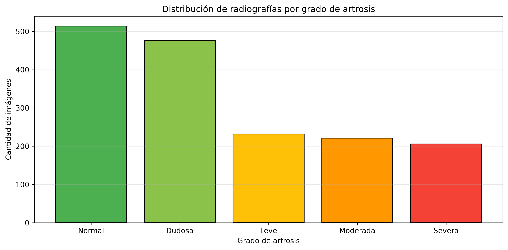
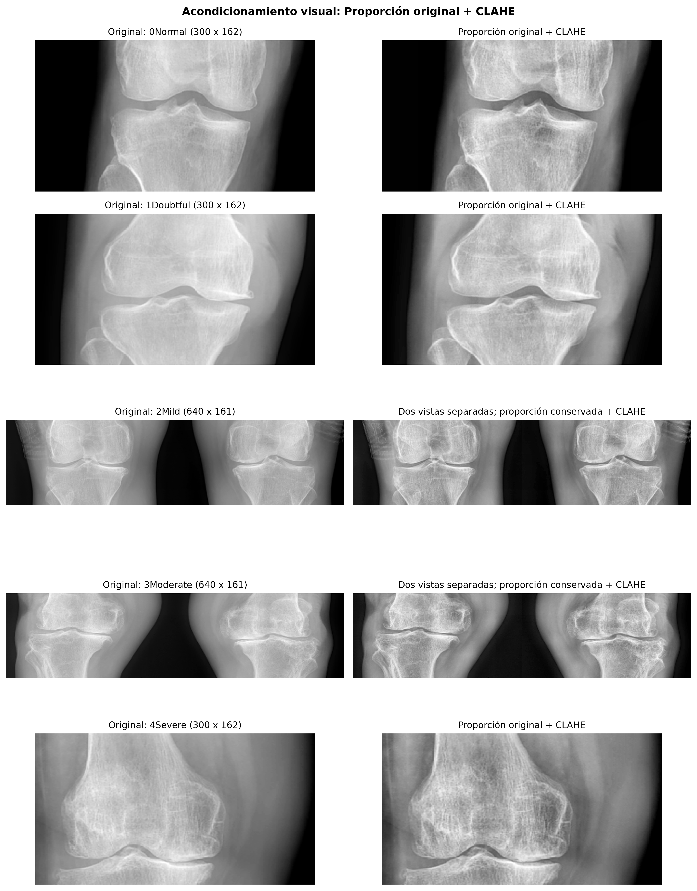
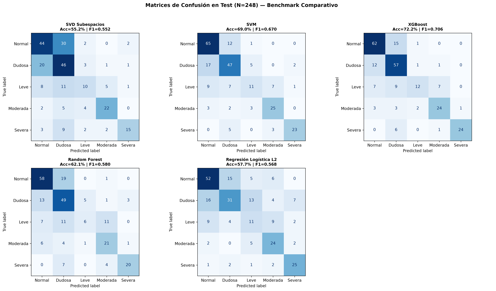
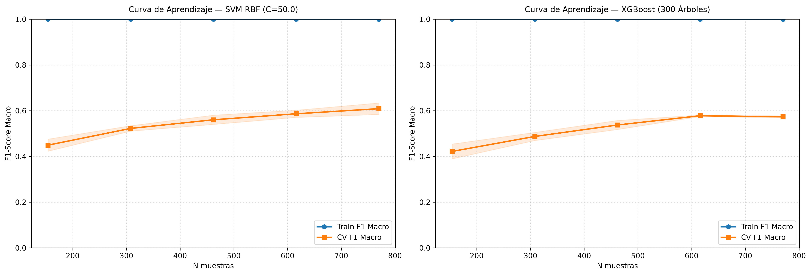
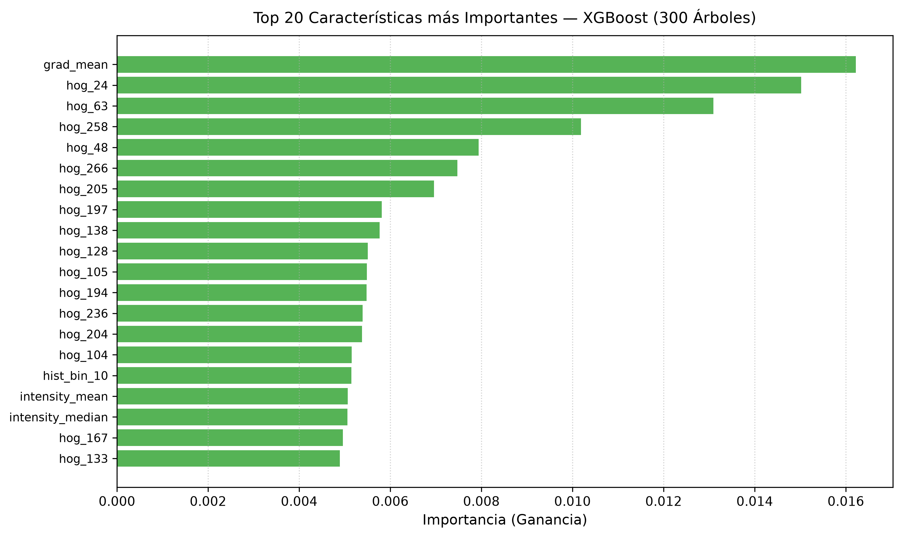

# Clasificación de artrosis de rodilla en radiografías

**Proyecto semestral · Machine Learning 1 (23433)**  
Facultad de Ingeniería, Universidad Nacional de Asunción (FIUNA)  
Carrera de Ingeniería Electrónica · Semestre 2026

**Autor:** Jorge Javier Palma Martínez  
**Correo:** jpalma@fiuna.edu.py · **GitHub:** [J-Palma](https://github.com/J-Palma)  
**Repositorio:** https://github.com/J-Palma/ML1_2026-2

> **Alcance:** estudio académico de clasificación de imágenes. El modelo no es un dispositivo médico, no fue validado clínicamente y no debe utilizarse para diagnosticar ni decidir tratamientos.

## Resumen

Se desarrolló un flujo reproducible para clasificar radiografías de rodilla en cinco grados de artrosis Kellgren–Lawrence: Normal, Dudosa, Leve, Moderada y Severa. Se analizaron 1.650 imágenes y se compararon cinco clasificadores: regresión logística, SVD por subespacios, SVM con kernel RBF, Random Forest y XGBoost. El mejor resultado en el test reservado fue XGBoost, con F1 macro de 0,7057 y accuracy de 72,18 %. El recall de la clase Leve fue bajo (0,3429), por lo que el promedio global no representa el mismo nivel de rendimiento en todos los grados.

## 1. Problema y objetivos

La tarea consiste en asignar cada imagen a uno de cinco niveles ordenados de severidad. El orden clínico de los grados importa: una confusión entre grados contiguos difiere de una confusión entre Normal y Severa. Este proyecto estudia si descriptores visuales clásicos permiten separar esas clases en el conjunto disponible.

**Objetivo general.** Comparar métodos de aprendizaje supervisado para clasificar los grados de artrosis de rodilla a partir de radiografías.

**Objetivos específicos.** Explorar el balance y las resoluciones; conservar la geometría anatómica en el acondicionamiento; extraer descriptores reproducibles; seleccionar hiperparámetros con validación; comparar los modelos con métricas multiclase; y documentar los límites del resultado.

## 2. Datos y análisis exploratorio

Se usó el conjunto público *Annotated Dataset for Knee Arthritis Detection* de Kaggle. Contiene 1.650 imágenes en cinco directorios de clase. La tabla de particiones utilizada en el proyecto asigna 1.155 imágenes al entrenamiento, 247 a validación y 248 a prueba, con estratificación por grado.

| Grado | Imágenes | Porcentaje |
|---|---:|---:|
| Normal | 514 | 31,2 % |
| Dudosa | 477 | 28,9 % |
| Leve | 232 | 14,1 % |
| Moderada | 221 | 13,4 % |
| Severa | 206 | 12,5 % |
| **Total** | **1.650** | **100 %** |

La mayoría de imágenes mide 300 × 162 píxeles (1.464); 186 miden 640 × 161. En algunos estudios aparecen ambas rodillas. El conjunto es pequeño y las clases no están equilibradas. Por ello, el análisis prioriza F1 macro y balanced accuracy junto con accuracy.

## 3. Acondicionamiento y características

Las imágenes se leen en escala de grises. El pipeline identifica radiografías bilaterales y separa sus vistas para el cálculo de descriptores. Cada vista se adapta a un tamaño fijo conservando su proporción; el relleno negro corresponde al espacio fuera de la imagen ajustada, no a un recorte de la zona anatómica. Se aplica CLAHE para realzar contraste local. Para conservar una fila por estudio, los descriptores de ambas vistas se promedian.

El extractor genera 320 valores por estudio, agrupados en estadísticas de intensidad, histograma, estadísticas espaciales, gradientes Sobel, Laplaciano y descriptor HOG. Los modelos de SVD emplean además una representación de píxeles de 64 × 64 (4.096 componentes). Los escaladores se ajustan con entrenamiento; para el modelo final se vuelven a ajustar con entrenamiento más validación antes de transformar test.

## 4. Modelos y evaluación

La partición de prueba (N=248) se reserva para la evaluación final. La elección de hiperparámetros se realiza con el conjunto de validación: SVD prueba rangos `k ∈ {5, 10, 15, 20, 30, 50}`; SVM RBF evalúa `C ∈ {0,1; 1; 10; 50}`; XGBoost compara 50, 100, 150, 200 y 300 árboles; Random Forest compara 100, 200 o 300 árboles y `min_samples_leaf ∈ {1, 2}`. La regresión logística L2 actúa como baseline.

Se reportan accuracy, balanced accuracy, precisión macro, recall macro, F1 macro y F1 ponderado. F1 macro es la métrica de selección principal porque calcula F1 por clase y luego promedia los cinco resultados con igual peso. La curva de aprendizaje de SVM y XGBoost usa validación cruzada estratificada de 3 folds y cinco tamaños de muestra para limitar el costo de cómputo.

## 5. Resultados

| Modelo | Accuracy | Balanced accuracy | F1 macro | F1 ponderado | Precisión macro | Recall macro |
|---|---:|---:|---:|---:|---:|---:|
| **XGBoost (300 árboles)** | **72,18 %** | **68,84 %** | **0,7057** | **0,7138** | **0,7617** | **0,6884** |
| SVM RBF (C=50) | 68,95 % | 66,18 % | 0,6702 | 0,6798 | 0,6968 | 0,6618 |
| Random Forest (200 árboles, hoja=2) | 62,10 % | 57,73 % | 0,5798 | 0,6051 | 0,6242 | 0,5773 |
| Regresión logística L2 | 57,66 % | 59,03 % | 0,5676 | 0,5709 | 0,5576 | 0,5903 |
| SVD por subespacios (k=30) | 55,24 % | 52,96 % | 0,5516 | 0,5500 | 0,6052 | 0,5296 |

En test, XGBoost obtiene el mayor F1 macro entre los cinco modelos. Por clase, sus valores F1 son: Normal 0,7654; Dudosa 0,7081; Leve 0,4706; Moderada 0,7273; Severa 0,8571. El recall de Leve (0,3429) es la principal debilidad observada. La clase Leve también tiene menos imágenes, lo cual puede contribuir a la dificultad, aunque esta evaluación no prueba la causa. La accuracy de 72,18 % por sí sola ocultaría esta diferencia.

La curva de aprendizaje debe leerse como diagnóstico de estos datos y esta configuración. La importancia de características de XGBoost describe la contribución interna del modelo; no constituye una explicación causal o clínica.

## 6. Conclusiones

1. Los descriptores visuales clásicos permiten una clasificación por encima del baseline en la partición analizada; XGBoost obtuvo F1 macro 0,7057.
2. El rendimiento varía entre grados. En particular, el recall bajo de Leve aconseja reportar las métricas por clase y no comunicar únicamente accuracy.
3. El preprocesamiento conserva la geometría y separa radiografías bilaterales antes de calcular características; la salida tabular contiene 320 descriptores por estudio.
4. La evaluación es interna y no demuestra generalización a pacientes, equipos, hospitales o poblaciones diferentes.

## 7. Limitaciones y trabajo futuro

El conjunto contiene pocas imágenes para una aplicación clínica y muestra desbalance entre grados. No se dispone en este proyecto de una cohorte externa independiente ni de información suficiente para verificar una separación por paciente. La clasificación ordinal se trató como clasificación multiclase estándar, de modo que las métricas no distinguen cuánto se aparta una predicción del grado real. El descriptor HOG y las características tabulares pueden perder contexto espacial fino. También debe tenerse en cuenta que la puntuación de importancia de árboles no explica por sí misma decisiones médicas.

Como siguientes pasos se propone obtener una partición por paciente, evaluar en un conjunto externo, estudiar métricas ordinales y revisar errores con especialistas. Una futura comparación con redes convolucionales preentrenadas debe mantener idénticas particiones y reportar resultados por clase. Se requieren controles de calidad, calibración y validación clínica antes de considerar cualquier uso aplicado.

## Referencias y recursos

- Dataset: [Annotated Dataset for Knee Arthritis Detection](https://www.kaggle.com/datasets/hafiznouman786/annotated-dataset-for-knee-arthritis-detection).
- Repositorio de referencia de la materia: [Machine-Learning](https://github.com/carlobeni/Machine-Learning).
- Ejemplo de página web del curso: [ML1-ECA: Next.js y deploy en Vercel](https://www.youtube.com/watch?v=isgBodVA2C4).
- Guía de TP4 de Machine Learning 1 (FIUNA), consultada para la estructura de documentación y despliegue.

**Repositorio del proyecto:** https://github.com/J-Palma/ML1_2026-2  
**Sitio del proyecto (URL prevista):** https://j-palma.github.io/ML1_2026-2/
